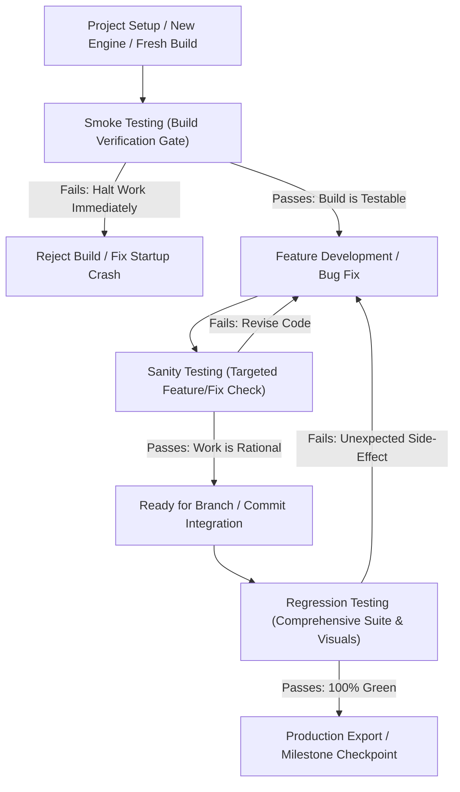

# Testing Strategies in Godot Dynamic Harness: Smoke, Sanity, and Regression Testing

A structured guide for developers and AI agents on executing **Smoke Testing**, **Sanity Testing**, and **Regression Testing** in Godot projects using the Godot Dynamic Harness.

---

## 1. Concepts & Definitions

Software testing in game development follows a tiered hierarchy to balance rapid development feedback against release stability. Refer to [TestingXperts Software Testing Types](https://www.testingxperts.com/blog/types-of-software-testing) for general software engineering taxonomy.



### Comparative Summary

| Testing Type | Scope & Breadth | Execution Time | When to Run | Primary Objective | Failure Action |
|---|---|---|---|---|---|
| **Smoke Testing** | **Broad & Shallow** | 5 – 15 seconds | After initial setup, engine version change, or fresh build | Verify critical path & startup stability: engine boots, autoloads initialize, main scene instantiates | **Block all work.** Do not proceed with feature work if the engine or root scene fails to launch. |
| **Sanity Testing** | **Narrow & Deep** | 2 – 10 seconds | Immediately after modifying a specific script, scene, or bug fix | Verify rationality of the specific modification without re-running entire suites | **Iterate on the fix.** The targeted logic or UI layout is not yet functionally correct. |
| **Regression Testing** | **Broad & Deep** | 30 – 120 seconds | Before pull requests, git commits, release exports, or after refactoring | Verify that modifications did not break existing gameplay, UI layouts, score rules, or engine compatibility | **Investigate side-effects.** New changes caused a regression in unrelated subsystems. |

---

## 2. Tier 1: Smoke Testing (Build Acceptance)

### What it Checks:
- Godot engine executable launches headlessly without crash.
- `project.godot` parsing and settings loading succeed.
- Autoload singletons initialize without runtime script errors.
- The default or selected main scene (`run/main_scene`) loads into the SceneTree.
- Basic display/viewport and environment shaders compile.

### Harness Commands:
```powershell
# 1. Main-scene smoke test execution (if generated during bootstrap with --smoke)
python game.py test --suite tests/test_harness_smoke.gd --json

# 2. Main-scene visual render smoke check (verifies graphics backend & layout)
python game.py capture --json
```

### Expected Output (`--json`):
```json
{
  "schema_version": 1,
  "command": "test",
  "status": "success",
  "summary": "1 suites passed (1 tests, 0 failures, 0 errors)",
  "findings": []
}
```

> [!IMPORTANT]
> **Smoke Gate Principle**: If smoke testing fails, **STOP**. Do not attempt to fix gameplay questions or author new UI components until the basic engine startup crash or autoload dependency error is resolved.

---

## 3. Tier 2: Sanity Testing (Focused Feature & Fix Verification)

### What it Checks:
- A specific bug fix solves the targeted issue (e.g., score calculation formula, UI button click, ingredient label).
- A newly modified GDScript parses, loads, and passes its unit test assertions.
- A modified `.tscn` scene renders its controls, fonts, and anchors correctly at target resolution.

### Harness Commands:
```powershell
# 1. Run only the specific test suite associated with the modified feature
python game.py test --suite tests/test_session_composition.gd --json

# 2. Render and inspect only the modified scene
python game.py capture --scene res://screens/modals/CategorySelectModal.tscn --width 720 --height 1280 --json

# 3. Native Godot engine parse & load check on modified project resources
python game.py validate --engine --json
```

### Workflow for AI Agents:
1. Make a surgical change to a script or scene.
2. Immediately trigger a sanity check on that exact file or test suite.
3. Review the returned `findings` and screenshot artifacts before touching any other code.

---

## 4. Tier 3: Regression Testing (Comprehensive Verification)

### What it Checks:
- All recursive test suites in `tests/` pass with 0 failures, 0 errors, and 0 unexpected skips.
- All project scenes still instantiate and render without crashing or missing resources.
- UI layouts across all scenes maintain design coherence (no cropped buttons, overlapping text, or misplaced anchors).
- GDScript code adheres to engine version compatibility rules and version changes.

### Harness Commands:
```powershell
# 1. Run all discovered SceneTree test suites recursively
python game.py test --json

# 2. Batch render all scenes to detect visual UI regressions
python game.py capture --all-scenes --json
# Or capture a key regression suite:
python game.py capture --scenes res://screens/Menu.tscn res://screens/Quiz.tscn res://screens/Results.tscn --json

# 3. Validate all static resource references and engine parse validity
python game.py validate --engine --json

# 4. Scan GDScript for version deprecations and migration patterns
python game.py syntax --scan . --json
```

### Visual Regression Review:
When running batch capture (`--all-scenes`), the harness produces:
- `qa-evidence/batch-grid/gallery.html`: Clickable HTML gallery linking full-resolution screenshots.
- `qa-evidence/batch-grid/contact_sheet_*.png`: Multi-page contact sheets grouping up to 6 scenes per image in 3 columns.
- Review these contact sheets to immediately spot visual regressions (such as altered font sizes or broken layout containers) across the entire project.

---

## 5. Next-Gen Quality & Verification Capabilities

### 5.1 Deterministic Task Routing (`plan-task`)
For workhorse models (e.g. Gemini 3.8 / Flash), `plan-task` classifies change scope and selects the proportionate verification tier deterministically:
```powershell
python game.py plan-task "Fix ground collision offset in Player.tscn" --json
```
Returns:
- `change_class`: `"Minor"` vs `"Major"`
- `tier`: `"minor-doc"`, `"minor-visual"`, `"minor-logic"`, or `"major"`
- `caveman_mode`: `"full"` (for coding/debugging token efficiency) or `"off"` (for prose/plans/lore)
- Exact 4-step checklist with target verification command.

### 5.2 Compact Scene Outlining (`scene-outline`)
Strips huge binary tile data (`PackedByteArray`) and raw subresources from `.tscn` files to emit a compact summary:
```powershell
python game.py scene-outline res://scenes/Player.tscn --json
```
Returns node hierarchy, unique names (`%Player`), scripts, and signal connections in `< 40 lines`.

### 5.3 Proportionate Test Tiers (`test --tier`)
Run tests matching the change tier:
```powershell
# Only run tests related to git-changed files:
python game.py test --changed --json

# Run smoke or sanity suites:
python game.py test --tier smoke --json
python game.py test --tier sanity --json
```
For `minor-doc` and `minor-visual` tasks, `test` automatically skips heavy scene execution with an explicit skip status.

### 5.4 Headless Layout Baseline Testing (`baseline`)
Save or mathematically diff Control hierarchies and node rects without GPU overhead:
```powershell
# Save initial reference layout:
python game.py baseline --save --scene res://Main.tscn --json

# Verify layout against baseline (fails on missing/shifted nodes or font changes):
python game.py baseline --check --scene res://Main.tscn --tolerance 1.0 --json
```

### 5.5 Asset Alpha & Aesthetic Rubric (`assets`)
Detect halos, empty padding, fake checkerboards, and track 3-tier rubric scores:
```powershell
# Audit asset padding, fringes, and grid alignment:
python game.py assets res://assets/player.png --json

# Crop transparent padding and nearest-neighbor scale:
python game.py assets --process res://assets/player.png --crop-alpha --scale 2 --json

# Defringe semi-transparent border halos:
python game.py assets --process res://assets/player.png --defringe --json

# Grade against 3-tier rubric (stored in .harness/asset-manifest.json):
python game.py assets --grade res://assets/player.png --t1 9.0 --t2 8.5 --t3 9.0 --json
```

### 5.6 In-Game Logic, Physics & Frame-Budget Audit (`audit`)
Deeply inspect scene setups, collision layers, signal wiring, and frame budget:
```powershell
# Audit physics collision layers, missing colliders, and Y-sort:
python game.py audit --physics --json

# Audit hardcoded gameplay numbers that should be @export:
python game.py audit --exports --json

# Audit signal wiring to ensure target receiver methods exist:
python game.py audit --signals --json

# Detect expensive queries (get_node, $, find_child, load) in _process loops:
python game.py audit --perf --json

# Audit Scene-First UI policies:
python game.py audit --scene-first --json
```

### 5.7 Save File & Repo Hygiene Verification
```powershell
# Inspect user:// and project save files:
python game.py saves --json

# Non-destructive repo hygiene audit (untracked tmp/bak files, uncommitted debug captures):
python game.py clean --audit --json
```

---

## 6. Integrating with Continuous Delivery & Checkpoints

Whenever completing a testing tier:
1. Refresh the project context and graph:
   ```powershell
   python game.py graph --refresh --json
   python game.py context --refresh --json
   ```
2. Checkpoint outcomes are automatically recorded in `docs/harness/CHECKPOINT.md`:
   - Strictly capped under `< 2 KB` to preserve workhorse model context budgets.
   - Summarizes top 5 findings, top 5 artifacts, and next command hints.

---

## 6. Project Capture Lifecycle & Artifact Cleanup

To prevent disk bloat from repeated scene renders and visual regression sweeps:

### Automatic Retention:
- Default captures written to `screenshots/debug/` automatically prune older sessions, keeping the **5 most recent** debug capture runs.
- You can override the retention limit:
  ```powershell
  python game.py capture --keep 3 --json
  ```
- Or force a purge of previous debug captures before rendering:
  ```powershell
  python game.py capture --clean --json
  ```

### Explicit Cleanup Commands:
- Purge all ephemeral debug screenshots and empty directories:
  ```powershell
  python game.py clean --captures --json
  ```
- Purge both debug captures and batch review galleries (`qa-evidence/`):
  ```powershell
  python game.py clean --all --json
  ```

### Version Control Safety:
- `screenshots/`, `qa-evidence/`, `*.png`, `scene_manifest.json`, and `batch_results.json` are strictly added to `.gitignore` during harness bootstrap to prevent binary images from polluting git history.

